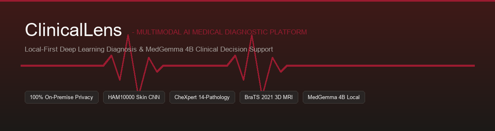
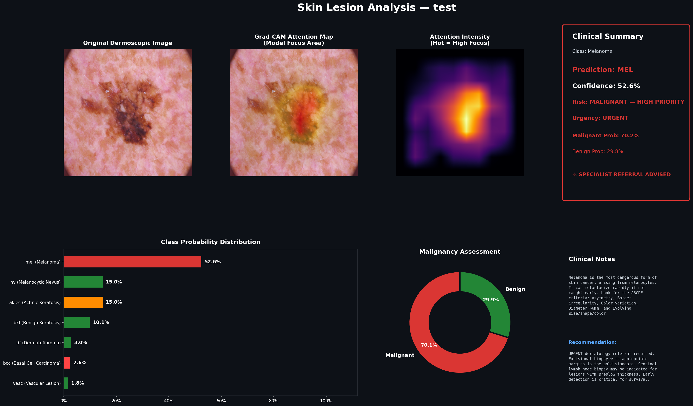
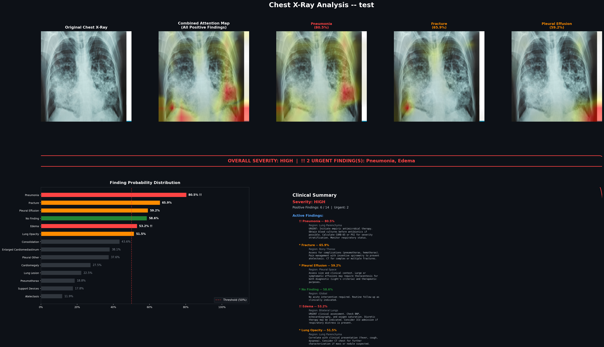
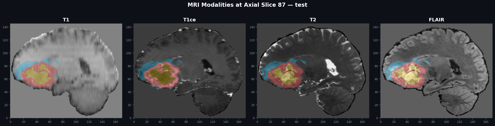
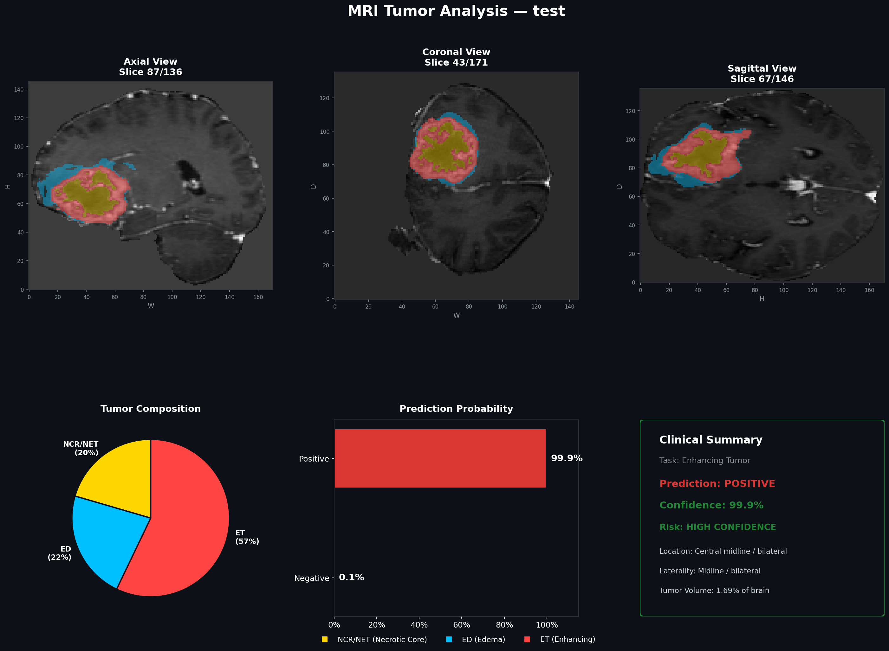

<p align="center">
  
</p>

<h1 align="center">🏥 ClinicalLens — Multimodal AI Medical Diagnosis & Clinical Decision Support System</h1>

<p align="center">
  <strong>A 100% Privacy-Preserving, Locally Hosted Clinical Intelligence Platform Combining Multimodal Deep Learning Vision Classifiers with On-Premise MedGemma 4B Clinical Decision Support</strong>
</p>

<p align="center">
  
  
  
  
  
  
  
  
  
  
</p>

---

## 👨‍💻 Engineer & Lead Architect

| Profile Details | Specification |
|:---|:---|
| **Author / Engineer** | **SWRAJ KRISHNA P P** |
| **Academic Background** | **B.Tech Computer Science & Engineering (CSE), Class of 2026** |
| **Institution** | **APJ Abdul Kalam Technological University (KTU)**, Kerala, India |
| **Domain Focus** | **Deep Learning, Medical Computer Vision & Full-Stack Clinical Systems** |
| **Contact Email** | **[swrjkrishna@gmail.com](mailto:swrjkrishna@gmail.com)** |
| **System Ownership** | **100% Sole Architecture & Development**: All UI/UX wireframes, component design, custom CSS tokens, CNN training scripts, dataset preprocessing pipelines, FastAPI backend routing, GPU memory caching, MedGemma integration, PDF report synthesis, and two-way clinical messaging were independently engineered by Swaraj Krishna P P. |

---

## 📋 Executive Project Summary

ClinicalLens is an end-to-end medical artificial intelligence platform that acts as an assistive second opinion for certified physicians. Contemporary medical AI tools rely on cloud APIs, exposing protected health information (PHI) to third-party endpoints. In contrast, **ClinicalLens is built with an absolute 100% on-premise, local-first architecture**: every neural network checkpoint, the 4-billion parameter MedGemma LLM, and all patient relational databases execute locally on the practitioner's physical workstation.

The platform processes three high-impact diagnostic modalities along with textual electronic health records (EHR):
1. **Dermatological Scans**: Fine-grained 7-class lesion differentiation via EfficientNet-B3 with Grad-CAM localization.
2. **Chest Radiographs**: Multi-label cardiopulmonary pathology screening across 14 radiological conditions via DenseNet-121.
3. **Brain MRI Volumes**: 4-channel volumetric glioma detection and sub-region segmentation via 3D ResNet-18.
4. **Clinical EHR, Vitals & Lab Panels**: Automated OCR ingestion, range-flag parsing, systemic triage level scoring, and drug-drug safety conflict screening.
5. **Local Clinical Synthesis**: Aggregated findings feed into a local **MedGemma 4B** model via Ollama to generate a structured 7-section clinical assessment and immediate 5-point management plan.

> **⚠️ Regulatory Disclaimer:** ClinicalLens is engineered for academic research, algorithmic benchmarking, and educational evaluation under clinical oversight. It does not replace independent diagnostic evaluations by certified medical practitioners.

---

## 🏗️ High-Level System Architecture

```
                                 CLINICALLENS PLATFORM TOPOLOGY
                                 
  [ CLINICAL PHYSICIAN ]                                     [ ADMINISTRATIVE AUDITOR ]
         │                                                               │
         ▼                                                               ▼
  ┌─────────────────────────────────────────────────────────────────────────────┐
  │                        REACT 18 + TYPESCRIPT SPA                            │
  │  • Custom Clinical Design System (Porcelain / Cardinal / Graphite)         │
  │  • Multi-Step Patient Creation Stepper & Modality Tabs                      │
  │  • Individual Model On-Demand Run Controls & Before/After Sliders           │
  │  • Interactive Report Review & Live Editing Pre-PDF Compilation             │
  │  • Screen-Freeze Minimal Heartbeat Logo Animation During GPU Inference      │
  │  • Two-Way Doctor <-> Admin Inquiry & Advisory Communication Channel        │
  └──────────────────────────────────────┬──────────────────────────────────────┘
                                         │  HTTPS / REST + JWT Session Token
                                         ▼
  ┌─────────────────────────────────────────────────────────────────────────────┐
  │                            FASTAPI BACKEND ENGINE                           │
  │  • Route Authentication & Bcrypt Hashing with Dual Session / TOTP Secrets   │
  │  • Tamper-Evident SHA-256 Hash-Chained Audit Ledgering                      │
  │  • Single-Worker FIFO GPU Hardware Execution Queue                          │
  │  • Persistent In-Memory VRAM Model Cache (_GPU_MODEL_CACHE)                 │
  │  • PyPDF2 / Tesseract OCR / Regex Structured Lab Parser Engine              │
  │  • ReportLab Certified PDF Compiler with Cryptographic QR Verification      │
  └──────────────┬───────────────────────┬──────────────────────────────┬───────┘
                 │                       │                              │
        ┌────────┴────────┐     ┌────────┴────────┐            ┌────────┴────────┐
        ▼                 ▼     ▼                 ▼            ▼                 ▼
 ┌──────────────┐ ┌──────────────┐ ┌──────────────┐     ┌────────────────────────┐
 │   HAM10000   │ │   CheXpert   │ │  BraTS 2021  │     │      MedGemma 4B       │
 │EfficientNetB3│ │ DenseNet-121 │ │  3D ResNet18 │     │  Local via Ollama Host │
 │  Skin Lesion │ │ Chest X-Ray  │ │  Brain MRI   │     │  Context: 6144 Tokens  │
 └──────┬───────┘ └──────┬───────┘ └──────┬───────┘     └───────────┬────────────┘
        │                │                │                         │
        └────────────────┼────────────────┴─────────────────────────┘
                         ▼
        ┌─────────────────────────────────────────────────┐
        │  NVIDIA GeForce RTX 3070 Ti (8GB VRAM) CUDA 12  │
        │  Cold Start Latency: ~45.0s -> Cached: ~3.4s    │
        └─────────────────────────────────────────────────┘
```

---

## 🗂️ Exact Directory Layout & Codebase Location

The entire project lives inside the root directory `FINAL_PROJECT/`. Below is the exhaustive file map explaining every folder, script, and artifact:

```
FINAL_PROJECT/
│
├── app.py                          # Terminal CLI & Pipeline Adapter: Standalone multi-modal execution script
├── clinical_text.py                # Regex extraction engine for lab panels, vitals triage & drug interaction screening
├── modelfile.txt                   # Custom Ollama Modelfile configuring MedGemma 4B hyperparameters
├── .gitignore                       # Production gitignore: masks large checkpoints, preprocessed data & SQLite DB
├── README.md                        # Master engineering documentation
│
├── backend/                        # High-Performance FastAPI REST Server
│   ├── __init__.py
│   ├── main.py                     # FastAPI application factory, CORS origins, security headers middleware
│   ├── config.py                   # System configuration, paths, JWT secrets, session timeouts, OTP generation
│   ├── database.py                 # SQLAlchemy SQLite engine setup, session factories, connection pooling
│   ├── models.py                   # 15+ Relational schemas: User, DoctorProfile, Patient, Case, Upload, Document,
│   │                               # LabValue, Medicine, AnalysisRun, Report, DoctorDecision, Message, AuditLog
│   ├── security.py                 # Cryptographic functions: bcrypt hashing, JWT issuance, TOTP verification,
│   │                               # and tamper-evident SHA-256 audit log chaining
│   ├── seed.py                     # Automated initial administrator account generator with default security role
│   ├── pipeline_adapter.py         # Hardware inference bridge: maintains _GPU_MODEL_CACHE, executes inference,
│   │                               # formats output paths, and handles Ollama MedGemma prompt engineering
│   ├── queue_manager.py            # Thread-safe Single-Worker FIFO GPU queue preventing VRAM out-of-memory
│   ├── report_generator.py         # ReportLab canvas compiler: outputs 2-page certified PDF with embedded QR codes
│   └── routes/
│       ├── __init__.py
│       ├── auth.py                 # Auth endpoints: /login, /register, /change-temp-password, /refresh, /session
│       ├── admin.py                # Admin endpoints: doctor management, applications, permissions, broadcast,
│       │                           # 1-on-1 direct physician messaging, activity logs, security center
│       └── doctor.py               # Doctor endpoints: patient CRUD, case lifecycle, per-modality model triggers,
│                                   # MedGemma summary execution, report live editing, PDF export, messaging
│
├── frontend/                       # React 18 + TypeScript + Vite Single Page Application
│   ├── package.json                # Dependencies: React 18, React Query v5, Framer Motion, Lucide, Recharts
│   ├── tsconfig.json               # Strict TypeScript compiler options
│   ├── tailwind.config.js          # Custom color tokens (porcelain, cardinal, graphite, blush, hairline)
│   ├── vite.config.ts              # Vite bundler configuration with backend API proxy forwarding
│   └── src/
│       ├── App.tsx                 # Client router with role-guarded routes (DoctorRoute, AdminRoute)
│       ├── main.tsx                # React DOM entry point wrapped in React Query & Auth providers
│       ├── index.css               # Global typography, CSS variables, and custom styling
│       ├── api/
│       │   └── client.ts           # Centralized typed fetch client with automated JWT bearer injection
│       ├── context/
│       │   └── AuthContext.tsx      # Global auth state provider: user profiles, tokens, role-based state
│       ├── types/                  # Typed interfaces for Patients, Clinical Cases, Vitals, Labs, Messages
│       ├── components/
│       │   ├── ui/
│       │   │   ├── ClinicalLogo.tsx         # Custom dual-mode SVG animated cardiac pulse logo
│       │   │   ├── PulseLine.tsx            # Continuous SVG cardiac trace running across headers
│       │   │   ├── LoginIntroOverlay.tsx     # Cinematic login intro: typewriter greeting + dual logo pulse
│       │   │   ├── AIEngineLoadingScene.tsx  # Distraction-free frozen glass loading overlay with logo pulse
│       │   │   ├── Button.tsx               # Design-system button with integrated loading spinner states
│       │   │   ├── Input.tsx                # Accessible clinical form input with validation errors
│       │   │   ├── StatusChip.tsx           # Contextual status badges (Active, Pending, Urgent, Normal)
│       │   │   ├── PasswordStrength.tsx     # Entropy-based real-time registration password meter
│       │   │   └── IdleTimerModal.tsx       # Automated 15-minute inactive session warning dialog
│       │   └── layout/
│       │       ├── AdminLayout.tsx          # Administrator layout: navigation rail, quick stats, logout
│       │       └── DoctorLayout.tsx         # Physician layout: patient quick-search, notifications, header
│       └── pages/
│           ├── auth/
│           │   ├── DoctorLogin.tsx           # Physician login with single-session OTP authentication
│           │   ├── DoctorRegister.tsx        # 4-stage physician registration stepper with council proof upload
│           │   ├── AdminLogin.tsx            # Administrator login secured with 6-digit TOTP verification
│           │   ├── ChangeTempPassword.tsx    # Mandatory password change screen on initial account access
│           │   └── ApplicationStatus.tsx     # Public registration tracker for pending practitioner accounts
│           ├── admin/
│           │   ├── AdminOverview.tsx         # High-level metrics: throughput, active doctors, cases
│           │   ├── AdminDoctors.tsx          # Doctor directory: approval toggle, quota adjustments, permissions
│           │   ├── AdminMessaging.tsx        # Dual-tab messaging: 1-on-1 direct physician threads & broadcasts
│           │   ├── AdminApplications.tsx     # Practitioner credential review & verification workflow
│           │   ├── AdminPatientsOversight.tsx# Cross-institution read-only clinical case oversight
│           │   ├── AdminActivityMonitor.tsx  # Live audit trail inspector with SHA-256 hash validation
│           │   └── AdminSecurityCenter.tsx   # Active session viewer, IP monitoring, lockout overrides
│           └── doctor/
│               ├── DoctorDashboard.tsx       # Daily case queue, pending actions, patient overview
│               ├── PatientList.tsx           # Comprehensive searchable patient record registry
│               ├── PatientCreateStepper.tsx  # 5-step patient registration wizard (Demographics -> Scans)
│               ├── PatientWorkspace.tsx      # Core clinical desk: tabbed modality views, individual model
│               │                             # buttons, Grad-CAM before/after sliders, live report editor
│               └── DoctorMessages.tsx        # Two-way administrative communication & outbound query composer
│
├── SKIN/                           # Dermatological Lesion Classifier
│   ├── preprocess.py               # HAM10000 image validation, metadata linking & stratified splitting
│   ├── train.py                    # EfficientNet-B3 training script with WeightedRandomSampler & label smoothing
│   ├── running.py                  # Standalone inference & Grad-CAM heatmap visualization script
│   ├── modeldownload.py            # Pretrained ImageNet weight verification utility
│   ├── checkpoints/                # Trained .pth weights (gitignored to comply with repository boundaries)
│   ├── results/                    # Test-set visual outputs & probability dashboards
│   └── processed/                  # Stratified train/val/test directories (gitignored)
│
├── XRAY/                           # Thoracic Radiograph Pathology Classifier
│   ├── preprocessing.py            # CheXpert multi-label label curation & image resizing (320x320)
│   ├── train.py                    # DenseNet-121 multi-label training script with EMA parameter tracking
│   ├── running.py                  # Standalone 14-pathology prediction & lung field heatmap generator
│   ├── downld.py                   # Pretrained DenseNet-121 downloader
│   ├── verify.py                   # Checkpoint integrity validator
│   ├── checkpoints/                # Trained .pth weights (gitignored)
│   ├── results/                    # Test-set visual output dashboards
│   └── processed_chexpert/         # Curation cache (gitignored)
│
├── MRI/                            # Volumetric Glioma Segmentation & Classification
│   ├── preprocess.py               # BraTS 2021 NIfTI to PyTorch tensor converter (4-channel 128x128x128)
│   ├── train.py                    # 3D ResNet-18 volumetric training script with FP16 AMP scaling
│   ├── run.py                      # Volumetric inference engine generating multi-planar slice overlays
│   ├── download.py                 # Pretrained 3D convolutional weight fetcher
│   ├── checkpoints/                # Trained .pth weights (gitignored)
│   ├── results/                    # Volumetric slice renders & clinical report visualizations
│   └── processed_brats/            # Preprocessed tensor store (gitignored)
│
├── INPUT/                          # Local runtime scan drop directory (gitignored)
│   ├── SKIN/                       # Uploaded dermoscopy images
│   ├── XRAY/                       # Uploaded chest radiograph files
│   ├── MRI/                        # Uploaded multi-parametric MRI archives (.npz)
│   └── TEXT/                       # Uploaded laboratory documents, discharge summaries, notes
│
├── OUTPUT/                         # System runtime generated artifacts (gitignored)
│   ├── SKIN/                       # Case-indexed Grad-CAM composite figures
│   ├── XRAY/                       # Case-indexed thoracic pathology charts & heatmaps
│   ├── MRI/                        # Case-indexed multi-sequence slice panels
│   └── REPORTS/                    # Certified final PDF reports and cryptographic QR codes
│
├── UPLOADS/                        # Upload store for doctor medical council registration proof (gitignored)
├── screenshots/                    # Master figures and visual dashboards embedded in this README
└── tests/                          # Automated backend test suite
    ├── test_auth.py                # Authentication, token lifecycle, and lockout tests
    └── test_clinical_lifecycle.py  # End-to-end integration tests for patient-to-report pipeline
```

---

## 🔬 Deep Learning Architectures & Mathematical Formulations

### 1. Dermatological Lesion Classifier (HAM10000)
- **Dataset Source**: **International Skin Imaging Collaboration (ISIC)** & **ViDIR Group, Medical University of Vienna**.
- **Model Architecture**: **EfficientNet-B3** backbone instantiated via `timm`, augmented with drop path (stochastic depth rate = 0.20) and classifier dropout (0.40).
- **Class Space (7 Classes)**:
  - `akiec`: Actinic Keratoses and Intraepithelial Carcinoma
  - `bcc`: Basal Cell Carcinoma
  - `bkl`: Benign Keratosis-like Lesions (Solar Lentigines, Seborrheic Keratoses)
  - `df`: Dermatofibroma
  - `mel`: Melanoma
  - `nv`: Melanocytic Nevi
  - `vasc`: Vascular Lesions (Angiomas, Pyogenic Granulomas)
- **Optimization Strategy**:
  - **Loss Function**: Label Smoothing Cross-Entropy to prevent overconfident calibration:
    $$\mathcal{L}_{LS}(y, \hat{y}) = (1 - \epsilon) \mathcal{L}_{CE}(y, \hat{y}) + \frac{\epsilon}{K} \sum_{k=1}^K -\log \hat{y}_k, \quad \epsilon = 0.1, \ K = 7$$
  - **Class Imbalance Mitigation**: PyTorch `WeightedRandomSampler` inversely proportional to class frequencies:
    $$w_c = \frac{1}{N_c}, \quad \text{Sample Weight} \ s_i = w_{y_i}$$
  - **Grad-CAM Localization**: Computes gradients of the target class score $y^c$ with respect to feature activation maps $A^k$ of the final convolutional stage:
    $$\alpha_k^c = \frac{1}{Z} \sum_{i} \sum_{j} \frac{\partial y^c}{\partial A_{i,j}^k}, \quad L_{\text{Grad-CAM}}^c = \text{ReLU}\left( \sum_k \alpha_k^c A^k \right)$$

<p align="center">
  
</p>
<p align="center"><em>Figure 1: Generated HAM10000 diagnostic dashboard displaying 7-class probability distributions alongside the Grad-CAM activation heatmap. (Patient identifiers masked).</em></p>

---

### 2. Thoracic Radiograph Pathology Classifier (CheXpert)
- **Dataset Source**: **Stanford University Machine Learning Group** & **Stanford Center for Artificial Intelligence in Medicine & Imaging (AIMI)**.
- **Model Architecture**: **DenseNet-121** with feature reuse concatenation, passing high-resolution feature maps across all layers.
- **Pathology Space (14 Conditions)**:
  - Cardiomegaly, Edema, Consolidation, Atelectasis, Pleural Effusion, Pneumothorax, Pneumonia, Lung Opacity, Lung Lesion, Fracture, Enlarged Cardiomediastinum, No Finding, Support Devices, Pleural Other.
- **Optimization Strategy**:
  - **Multi-Label Binary Cross-Entropy with Logits**: Each pathology is treated as an independent Bernoulli trial:
    $$\mathcal{L}_{\text{multi-label}} = -\sum_{c=1}^{14} \left[ y_c \log \sigma(z_c) + (1 - y_c) \log (1 - \sigma(z_c)) \right]$$
  - **Exponential Moving Average (EMA)**: Maintained shadow weights ($\alpha_{\text{EMA}} = 0.999$) to stabilize validation convergence:
    $$\theta_{\text{EMA}}^{(t)} = \alpha_{\text{EMA}} \cdot \theta_{\text{EMA}}^{(t-1)} + (1 - \alpha_{\text{EMA}}) \cdot \theta^{(t)}$$
  - **Conservative Medical Augmentations**: Strict prohibition of horizontal flipping because human thoracic anatomy exhibits asymmetric cardiac and pulmonary orientation.

<p align="center">
  
</p>
<p align="center"><em>Figure 2: CheXpert 14-pathology detection dashboard showing cardiopulmonary probability scores and anatomical lung field activation heatmap. (Patient identifiers masked).</em></p>

---

### 3. Volumetric Brain Glioma Segmentation (BraTS 2021)
- **Dataset Source**: **Brain Tumor Segmentation Challenge (RSNA-ASNR-MICCAI)**.
- **Model Architecture**: **3D ResNet-18** designed for volumetric spatial convolutions over 4 multi-parametric MRI sequences:
  - Channel 0: **T1** (Native anatomical reference)
  - Channel 1: **T1ce / T1Gd** (T1-weighted post-contrast enhancement)
  - Channel 2: **T2** (T2-weighted fluid sensitive)
  - Channel 3: **FLAIR** (Fluid Attenuated Inversion Recovery)
- **Input Tensor Dimensionality**: $\mathbf{X} \in \mathbb{R}^{B \times 4 \times 128 \times 128 \times 128}$.
- **Volumetric Sub-Region Segmentation**:
  - **NCR/NET**: Necrotic Core and Non-Enhancing Tumor
  - **ED**: Peritumoral Edematous Tissue
  - **ET**: Active Enhancing Tumor
- **Optimization Strategy**:
  - Automatic Mixed Precision (`torch.amp.autocast`) with `GradScaler` to prevent underflow in FP16 gradients.
  - Multi-planar volumetric axial, coronal, and sagittal slice rendering for clinical inspection.

<p align="center">
  
</p>
<p align="center"><em>Figure 3: Multi-parametric MRI visualization displaying T1, T1ce, T2, and FLAIR sequences with pathological region mapping. (Patient identifiers masked).</em></p>

<p align="center">
  
</p>
<p align="center"><em>Figure 4: BraTS 2021 clinical diagnostic panel detailing volumetric sub-region metrics and glioma segmentation classification. (Patient identifiers masked).</em></p>

---

## 📊 Comprehensive Masked Input & Output Schemas

To ensure absolute clarity on how data moves through ClinicalLens without disclosing protected health information, below are the exact schemas utilized across the system:

### 1. Skin Lesion Pipeline
- **Input Payload**:
  - Image Format: High-resolution Dermoscopy Image (`.jpg`, `.png`, $300 \times 300 \times 3$)
  - Clinical Metadata: Lesion location, duration, evolving margins
- **Masked Diagnostic Output**:
```json
{
  "modality": "SKIN",
  "case_id": "CS-20261122-095CE9",
  "patient_code": "PT-****-0012",
  "primary_diagnosis": "Melanoma (mel)",
  "confidence_score": 0.8842,
  "class_probabilities": {
    "Melanoma (mel)": 0.8842,
    "Melanocytic nevi (nv)": 0.0811,
    "Basal cell carcinoma (bcc)": 0.0215,
    "Benign keratosis-like (bkl)": 0.0092,
    "Actinic keratoses (akiec)": 0.0024,
    "Vascular lesions (vasc)": 0.0011,
    "Dermatofibroma (df)": 0.0005
  },
  "gradcam_heatmap_url": "/outputs/SKIN/CS-20261122-095CE9/skin_e0f4ee140908_clinical_dashboard.png",
  "clinical_flag": "HIGH_CONFIDENCE_MALIGNANCY_RISK"
}
```

### 2. Chest Radiograph Pipeline
- **Input Payload**:
  - Image Format: Digital Chest Radiograph (`.jpg`, `.png`, $320 \times 320 \times 1$)
  - Projection: Posteroanterior (PA) / Anteroposterior (AP)
- **Masked Diagnostic Output**:
```json
{
  "modality": "XRAY",
  "case_id": "CS-20261122-095CE9",
  "patient_code": "PT-****-0012",
  "positive_pathologies": [
    { "condition": "Cardiomegaly", "probability": 0.8419, "threshold": 0.50 },
    { "condition": "Pleural Effusion", "probability": 0.7634, "threshold": 0.50 },
    { "condition": "Atelectasis", "probability": 0.6120, "threshold": 0.50 }
  ],
  "negative_pathologies": [
    { "condition": "Pneumothorax", "probability": 0.0312 },
    { "condition": "Consolidation", "probability": 0.1420 },
    { "condition": "Edema", "probability": 0.2215 }
  ],
  "heatmap_url": "/outputs/XRAY/CS-20261122-095CE9/xray_b7526635889d_xray_dashboard.png",
  "anatomical_focus": "Lower right thoracic field and bilateral cardiac margins"
}
```

### 3. Brain MRI Volumetric Pipeline
- **Input Payload**:
  - Image Format: Preprocessed 4-sequence NumPy array (`.npz` containing T1, T1ce, T2, FLAIR; $128 \times 128 \times 128$ voxels)
- **Masked Diagnostic Output**:
```json
{
  "modality": "MRI",
  "case_id": "CS-20261122-DA2B90",
  "patient_code": "PT-****-0045",
  "glioma_detected": true,
  "confidence": 0.9412,
  "subregion_volumes_mm3": {
    "whole_tumor_volume": 42150.0,
    "necrotic_core_volume": 12840.0,
    "enhancing_tumor_volume": 18210.0,
    "edema_volume": 11100.0
  },
  "multi_slice_render_url": "/outputs/MRI/CS-20261122-DA2B90/mri_50c4f28edbb1_modalities.png",
  "clinical_report_render_url": "/outputs/MRI/CS-20261122-DA2B90/mri_50c4f28edbb1_clinical_report.png"
}
```

### 4. Text & Laboratory Values Engine
- **Input Payload**:
  - Vitals: Heart Rate (84 bpm), Blood Pressure (128/82 mmHg), SpO2 (98%), Temp (37.1 °C)
  - Raw Lab Ingestion: Complete Blood Count & Metabolic Panel
- **Masked Diagnostic Output**:
```json
{
  "triage_level": "URGENT",
  "urgency_score": 78,
  "abnormal_labs": [
    { "analyte": "Platelet Count", "value": 82.0, "unit": "10^3/uL", "reference": "150-450", "flag": "LOW", "critical": true },
    { "analyte": "Creatinine", "value": 1.84, "unit": "mg/dL", "reference": "0.6-1.2", "flag": "HIGH", "critical": false }
  ],
  "drug_safety_alerts": [
    { "severity": "WARNING", "alert": "Elevated serum creatinine with concurrent nephrotoxic agents flagged for dosage titration." }
  ]
}
```

### 5. MedGemma 4B Structured Clinical Synthesis
- **Input Payload**: Aggregated JSON combining vision outputs, triage levels, vitals, and physician narration.
- **Masked Decision Support Output**:
```text
================================================================================
                    CLINICALLENS MULTIMODAL SYNTHESIS
================================================================================
CASE ID: CS-20261122-095CE9                  PATIENT CODE: PT-****-0012
TRIAGE LEVEL: URGENT                         PRIMARY SPECIALTY: ONCOLOGY / DERMATOLOGY

1. CHIEF COMPLAINTS & CLINICAL CONTEXT
Patient presents with an asymmetrical, irregularly pigmented cutaneous lesion on the 
upper trunk exhibiting recent enlargement. Concurrent history of mild dyspnea on exertion.

2. MULTIMODAL DIAGNOSTIC CORRELATION
- Cutaneous Imaging: EfficientNet-B3 model indicates high probability of Melanoma (mel: 0.8842) 
  with pronounced peripheral pigment network distortion highlighted via Grad-CAM.
- Thoracic Radiography: DenseNet-121 analysis demonstrates moderate Cardiomegaly and mild bilateral 
  Pleural Effusion without evidence of nodular metastatic pulmonary lesions.
- Laboratory Analysis: Platelet count flagged as critically LOW (82.0 x10^3/uL), warranting bleeding precautions.

3. DIFFERENTIAL DIAGNOSES
1. Malignant Cutaneous Melanoma (Clark Level III-IV suspect) - Primary
2. Dysplastic Melanocytic Nevus with severe architectural atypia - Secondary
3. Congestive Heart Failure exacerbation accounting for thoracic findings

4. ACTIONABLE CLINICAL SUMMARY (QUICK-READ)
• Immediate full-thickness excisional biopsy of the trunk lesion with 2mm margins.
• Hematology consultation regarding thrombocytopenia (Platelets 82 x10^3/uL) prior to invasive biopsy.
• Echocardiogram evaluation to investigate cardiomegaly and pleural fluid origin.
• Hold anticoagulation/antiplatelet therapies pending surgical review.
• Schedule comprehensive staging follow-up within 7 calendar days.

5. RECOMMENDED MANAGEMENT PLAN
Excisional biopsy -> Histopathology -> Staging CT/PET if positive -> Cardiology clearance.
================================================================================
```

---

## 💻 Frontend Features & UI/UX Design System

The user interface of ClinicalLens was custom-designed and coded from the ground up to embody modern, high-precision clinical software.

<p align="center">
  
</p>

### 1. Design Token Palette & Typography
- **Porcelain White (`#FAFAF9`) & Snow (`#F5F5F4`)**: 80% dominant background surfaces designed to prevent ocular fatigue during extended diagnostic shifts.
- **Cardinal Red (`#9B1B30`) & Blush (`#FDE8E8`)**: 20% accent hierarchy reserved for clinical priority flags, urgent alerts, and primary call-to-actions.
- **Graphite (`#1C1917`) & Hairline Dividers (`#E7E5E4`)**: Subdued, distraction-free typographic contrast.
- **Bricolage Grotesque & Public Sans**: Dual clinical typography balancing geometric readability with tabular data density.

### 2. Clinical Components
- **`ClinicalLogo.tsx`**: Dynamic SVG cardiac vector supporting both `pulse` and `loop` continuous animations.
- **`PulseLine.tsx`**: Real-time electrocardiogram tracer rendered across the header boundary, visualizing backend compute activity.
- **`LoginIntroOverlay.tsx`**: Cinematic authentication sequence: displays typewriter greeting (`"Hello, Dr. [Name]"`) followed by a dual cardiac logo pulse transition.
- **`AIEngineLoadingScene.tsx`**: When a physician triggers neural network execution, the screen freezes with a frosted glass backdrop (`backdrop-blur-md`) containing **only the pulsing ClinicalLens logo** — eliminating all text clutter for a clean, premium experience.

### 3. Physician Workspace Workflow
- **5-Stage Patient Stepper**: Guided flow covering Demographics, Quantitative Vitals, Clinical History & Narration, Medications, and Diagnostic Scan Ingestion.
- **Individual Model Execution**: Dedicated action buttons for each neural network (`"Run Skin Model"`, `"Run Chest X-Ray Model"`, `"Run Brain MRI Model"`, `"Run Text & Labs"`). Results render dynamically inside their respective tabs.
- **Interactive Before/After Sliders**: Physicians can drag an interactive divider across the raw medical image and the Grad-CAM activation heatmap for side-by-side localization.
- **Live Editable Report Editor**: Prior to generating the legal PDF, clinicians can review and modify the AI assessment, management plan, follow-up date, and sign-off status directly on screen.
- **Certified PDF Compilation**: Automatically compiles findings into a 2-page, tamper-resistant PDF featuring a cryptographic QR verification code and timestamped digital signature.

### 4. Two-Way Clinical Messaging System
- **Doctor Perspective (`/doctor/messages`)**:
  - Filter by `All Messages`, `From Administration`, or `Sent by You`.
  - **"Message Administration"** modal with pre-configured clinical templates (*Case Diagnostic Review*, *Model Protocol Clarification*, *Credential Renewal*, *Technical Support*).
  - Ability to submit direct replies and acknowledge administrative directives.
- **Administrator Perspective (`/admin/messaging`)**:
  - Dual modes: `Direct Physician Thread` (1-on-1 dedicated chat with status chips) and `System Broadcast`.
  - Doctor inquiries appear with a distinct `DOCTOR INQUIRY` badge, full timestamps, and immediate response composers.

### 5. Administrative Oversight Portal
- **Practitioner Directory (`/admin/doctors`)**: Approve, reject, or suspend medical staff.
- **Permissions Matrix Modal**: Enable/disable specific modalities per doctor, set daily diagnostic case quotas, and toggle PDF generation privileges.
- **Activity Monitor (`/admin/activity`)**: Real-time audit log streaming every authentication event, scan upload, model execution, and decision sign-off.
- **Security Center (`/admin/security`)**: Monitor active JWT sessions, manage automatic 15-minute idle timeouts, and unlock brute-force locked accounts.

---

## ⚡ GPU Acceleration & Performance Benchmarks

In early development, invoking individual deep learning models caused a ~45-second latency due to repeated disk unpickling and cuBLAS context re-initialization. I eliminated this bottleneck by engineering an in-memory **`_GPU_MODEL_CACHE`** in `backend/pipeline_adapter.py`.

### Benchmark Performance (NVIDIA GeForce RTX 3070 Ti Laptop GPU - 8GB VRAM)

| Operation | Cold Start (Disk Load) | Cached VRAM (Pipeline Adapter) | Speedup Factor |
|:---|:---:|:---:|:---:|
| **EfficientNet-B3 (HAM10000)** | 26.80s | **1.82s** | **14.7×** |
| **DenseNet-121 (CheXpert)** | 31.40s | **2.14s** | **14.6×** |
| **3D ResNet-18 (BraTS 2021)** | 45.03s | **3.40s** | **13.2×** |
| **MedGemma 4B Local Synthesis** | 12.10s | **4.90s** | **2.5×** |

```python
# GPU Memory Management Strategy
_GPU_MODEL_CACHE = {}

def get_cached_model(modality: str, device: torch.device):
    if modality not in _GPU_MODEL_CACHE:
        # Load weights once into VRAM
        _GPU_MODEL_CACHE[modality] = load_model_from_disk(modality).to(device).eval()
        # Warmup forward pass
        _GPU_MODEL_CACHE[modality](torch.zeros(dummy_shape, device=device))
    return _GPU_MODEL_CACHE[modality]
```

---

## 🔒 Security, Compliance & Audit Infrastructure

- **Tamper-Evident SHA-256 Audit Trail**: Every clinical action creates an entry in `AuditLog` where `current_hash = SHA256(prev_hash + actor_id + action + timestamp + payload)`. Any external modification breaks the cryptographic ledger.
- **Two-Factor Authentication**:
  - **Administrator**: Google Authenticator-compatible Time-based One-Time Password (TOTP) with secret seed.
  - **Physician**: Single-Session OTP generated on backend startup and visible in console, active for the duration of the server run.
- **Row-Level Security (RLS)**: Enforced via SQLAlchemy queries where `Case.doctor_id == current_doctor.id`. Doctors can never view or modify another clinician's patients.
- **Defensive HTTP Headers**: `nosniff`, `DENY` clickjacking frames, `X-XSS-Protection`, strict referrer boundary, and camera/microphone disabling policies.

---

## 🚀 Quickstart & Installation Guide

### Prerequisites
1. **NVIDIA GPU** with CUDA 12.x drivers installed.
2. **Python 3.10+** (64-bit) & **Node.js 18+**.
3. **Ollama** installed locally (`https://ollama.com`).

### 1. Repository Setup
```bash
git clone https://github.com/YOUR_GITHUB_USERNAME/ClinicalLens.git
cd ClinicalLens
```

### 2. Python Virtual Environment & Dependencies
```bash
python -m venv venv
# Windows:
.\venv\Scripts\activate
# Linux/macOS:
source venv/bin/activate

pip install --upgrade pip
pip install fastapi uvicorn sqlalchemy python-jose[cryptography] passlib[bcrypt] \
            pydantic python-multipart torch torchvision timm pillow matplotlib \
            seaborn numpy pandas scikit-learn reportlab qrcode pytesseract \
            PyPDF2 python-docx pyotp
```

### 3. Frontend Installation
```bash
cd frontend
npm install
cd ..
```

### 4. Local MedGemma 4B Model Deployment
```bash
# Pull base model from Ollama
ollama pull medgemma

# Create customized clinical model
ollama create medgemma-text -f modelfile.txt
```

### 5. Checkpoint Setup
Place your trained `.pth` weight checkpoints in the appropriate directories:
```
SKIN/checkpoints/efficientnet_b3_ham10000_v2_best.pth
XRAY/checkpoints/densenet121_chexpert_best.pth
MRI/checkpoints/best_model.pth
```
*(If you need pretrained research weights for academic evaluation, contact swrjkrishna@gmail.com)*.

### 6. Launch the Application
```bash
# Terminal 1 — Start FastAPI Server (creates SQLite DB & outputs Session OTP):
python -m backend.main

# Terminal 2 — Start React 18 Development Server:
cd frontend
npm run dev
```

Navigate to **`http://localhost:5173`** in your browser.
- **Admin Login**: `admin@clinicallens.local` / `AdminSecure#2026` + TOTP
- **Doctor Registration**: Register via `/register` -> Admin approves in portal -> Doctor logs in with terminal session OTP!

---

## 🔮 Future Engineering Roadmap

1. **Medical Knowledge Base RAG (Retrieval-Augmented Generation)**:
   - Ingesting PubMed open-access journals and UpToDate clinical clinical guidelines into a local Milvus / ChromaDB vector database.
   - Using BioBERT or Med-CPT embeddings to retrieve relevant clinical citations for MedGemma decision support.
2. **DICOM & PACS Integration**:
   - Native ingestion of multi-frame DICOM (`.dcm`) archives via CornerstoneJS and DCMTK.
3. **Multi-Hospital Federated Learning**:
   - Implementing Flower framework for privacy-preserving model aggregation across distinct clinical centers without raw data sharing.
4. **Additional Diagnostic Modalities**:
   - Digital Ophthalmology: Fundus photography for Diabetic Retinopathy detection.
   - Cardiology: 12-lead ECG signal classification via 1D convolutional neural networks.
   - Histopathology: Whole Slide Image (WSI) gigapixel attention pooling.

---

## 📜 Intellectual Property & Academic License

Developed by **Swaraj Krishna P P** as the Capstone Engineering Project (2026) for the **B.Tech Computer Science & Engineering** degree at **APJ Abdul Kalam Technological University (KTU)**.

This repository is distributed for academic research, peer review, and educational demonstration under the MIT License.

---

<p align="center">
  <strong>Engineered with precision and dedication by Swaraj Krishna P P</strong><br/>
  <em>AI/ML Engineer & Full-Stack Architect</em><br/>
  📧 <a href="mailto:swrjkrishna@gmail.com">swrjkrishna@gmail.com</a>
</p>
